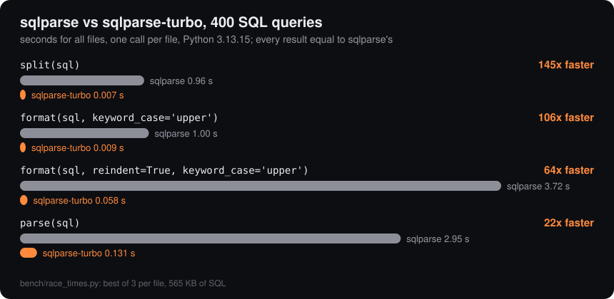
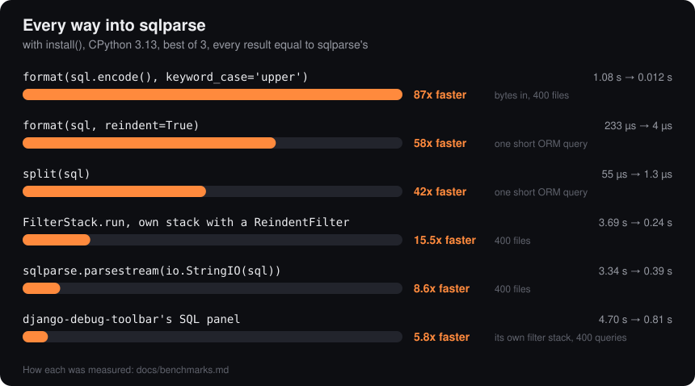
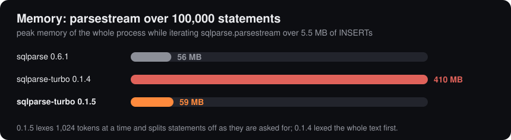

# Benchmarks

Every number here compares sqlparse 0.6.1 with sqlparse-turbo through the same public calls, and every result
was checked equal to sqlparse's.

- [Measure it yourself](#measure-it-yourself)
- [400 query files](#400-query-files)
- [The whole corpus](#the-whole-corpus)
- [Other ways into sqlparse](#other-ways-into-sqlparse)
- [`parse` and the garbage collector](#parse-and-the-garbage-collector)
- [Memory](#memory)
- [Against markocerkez/sqlparse-rs](#against-markocerkezsqlparse-rs)
- [How the numbers were made](#how-the-numbers-were-made)

## Measure it yourself

[`bench/quick_speed.py`](../bench/quick_speed.py) needs nothing but the two packages and takes a few seconds:

```sh
pip install "sqlparse==0.6.1" sqlparse-turbo
python bench/quick_speed.py
```

```
sqlparse 0.6.1, Rust on: True
SQL: 18 KB, 90 statements

                              sqlparse       turbo    faster
format(reindent, upper)         145 ms      1.5 ms      100x
split                            38 ms      0.2 ms      213x
parse                           115 ms      3.9 ms       29x
```

That run was on Windows 11 with CPython 3.13. Put your own SQL in `QUERY` to try it on that.

## 400 query files



[`bench/race_times.py`](../bench/race_times.py): one call per file, best of 3 per file. The chart and the README's
animation are drawn from its times by [`tools/make_visuals.py`](../tools/make_visuals.py).

## The whole corpus

440 files, 2.1 MB of SQL: generated queries and scripts. CPython 3.11, Windows 11, best of 3
([`bench/bench_package.py`](../bench/bench_package.py)):

| Call | sqlparse | sqlparse_turbo | Speed-up |
| --- | ---: | ---: | ---: |
| `split(sql)` | 4.30 s | 0.037 s | **116x** |
| `format(sql, keyword_case='upper')` | 4.82 s | 0.046 s | **105x** |
| `format(sql, reindent=True, keyword_case='upper')` | 13.57 s | 0.218 s | **62x** |
| `format(sql, strip_comments=True)` | 11.69 s | 0.152 s | **77x** |
| `format(sql, reindent_aligned=True)` | 12.33 s | 0.179 s | **69x** |
| `format(sql, reindent=True, indent_columns=True, comma_first=True)` | 13.18 s | 0.197 s | **67x** |

Two more, on the 400 query files:

- `split_many` takes 0.003 s against sqlparse's 1.07 s (12 threads).
- With `install()`, sqlparse's `lexer.tokenize` is 20x faster.

## Other ways into sqlparse



With `install()`, the same 400 query files, CPython 3.13, best of 3:

| Call | sqlparse | sqlparse_turbo | Speed-up |
| --- | ---: | ---: | ---: |
| `format(sql.encode(), keyword_case='upper')`, bytes in | 1.08 s | 0.012 s | **87x** |
| `sqlparse.parsestream(io.StringIO(sql))` | 3.34 s | 0.39 s | **8.6x** |
| `FilterStack.run`, a stack of the caller's own with a `ReindentFilter` | 3.69 s | 0.24 s | **15.5x** |
| django-debug-toolbar's SQL panel (its own two stacks, its own filters) | 4.89 s | 0.079 s | **62x** |
| `format(sql, reindent=True)` on a short ORM query, one call | 233 µs | 4 µs | **58x** |
| `split(sql)` on a short ORM query, one call | 55 µs | 1.3 µs | **42x** |

The toolbar's panel runs its own filters in Rust too, when they are the code the Rust reproduces
([Django](django.md)).

## `parse` and the garbage collector

`parse(sql)` over the 400 query files: sqlparse 2.9 s, sqlparse_turbo 0.10 s (**30x**).

`parse` has to hand back sqlparse's own Python objects, thousands of them for a big text, so it gains less than
`format` and `split`, which return strings.

A tree is a reference cycle (`parent` and `tokens`), so freeing one waits for the garbage collector, in sqlparse
as here. A program that keeps many trees pays for that collection: the 400 files' trees kept cost 0.26 s, and
0.07 s with the collector off.

## Memory



Since 0.1.5, `FilterStack.run` and `parsestream` hold about what sqlparse's generators hold: the text and the
statement being made.

- Statements are lexed 1,024 tokens at a time and split off as they are asked for.
- 0.1.4 lexed the whole text first.
- Iterating `parsestream` over 100,000 INSERT statements (5.5 MB) peaks at 59 MB, sqlparse at 56 MB (0.1.4:
  410 MB). `format` and `split` run as fast as in 0.1.4.

## Against markocerkez/sqlparse-rs

[markocerkez/sqlparse-rs](https://github.com/markocerkez/sqlparse-rs) (PyPI `sqlparse-rs` 0.1.0, imported as
`sqlparse_rs`) ports sqlparse's lexer and `split` to Rust. Grouping and the filters, so `format`, stay in Python.

Both packages on the same 400 query files (579 KB), same machine, best of 3, every result equal to sqlparse's.
Measured with sqlparse-turbo 0.1.2.

| Call | sqlparse | markocerkez | this one |
| --- | ---: | ---: | ---: |
| `split`, each file (CPython 3.13) | 1.00 s | 0.014 s | **0.008 s** |
| `format(keyword_case='upper')` (3.13) | 1.04 s | 0.33 s | **0.011 s** |
| `format(strip_comments=True)` (3.13) | 3.15 s | 2.48 s | **0.043 s** |
| `format(reindent=True, keyword_case='upper')` (3.13) | 3.73 s | 3.04 s | **0.062 s** |
| `format(reindent_aligned=True)` (3.13) | 3.42 s | 2.71 s | **0.052 s** |
| `split_many`, all files (3.13) | 1.02 s | 0.005 s | **0.003 s** |
| `lexer.tokenize`, each file (3.13) | 0.72 s | 0.034 s | 0.032 s |
| `parse`, each file (3.13) | 3.03 s | 2.30 s | **0.18 s** |
| `split`, each file (CPython 3.11) | 0.97 s | 0.76 s | **0.010 s** |
| `format(reindent=True, keyword_case='upper')` (3.11) | 3.65 s | 3.71 s | **0.065 s** |

Its Rust tables follow the Unicode version of the Python it was generated on (3.13). On every other Python it hands
all non-ASCII text to sqlparse: on 3.11, 243 of the 400 files, and a whole script as soon as any of it is
non-ASCII.
This package keeps the Rust for all text but the few code points that changed between Unicode versions (see
[Unicode versions](fallback.md#unicode-versions)).

## How the numbers were made

| Script | What it measures |
| --- | --- |
| [`bench/quick_speed.py`](../bench/quick_speed.py) | a few seconds on one generated text, for anyone to run |
| [`bench/race_times.py`](../bench/race_times.py) | each of the 400 query files, per call; feeds the chart and the animation |
| [`bench/bench_package.py`](../bench/bench_package.py) | the whole corpus through the package's public calls |
| [`bench/django_toolbar.py`](../bench/django_toolbar.py) | django-debug-toolbar's SQL panel and a page of 200 ORM queries |
| [`bench/gen_corpus.py`](../bench/gen_corpus.py) | writes the corpus (same seed, same bytes) |

The Rust alone, without Python, is measured with `cargo run --release --example bench_format` (also
`bench_lexer`, `bench_split`); see [Internals](internals.md#speed).
