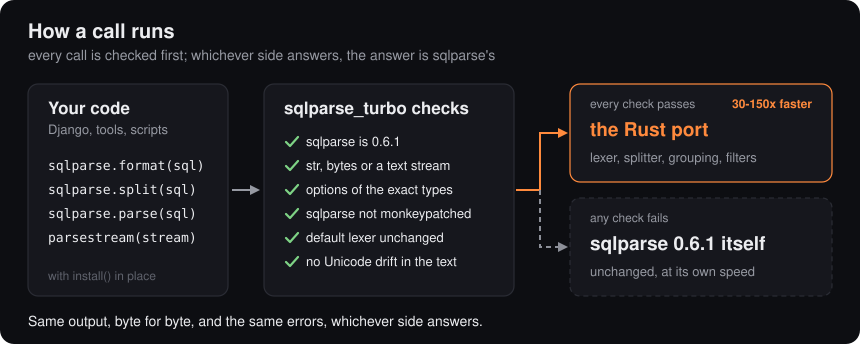

# When the Rust runs, and when sqlparse does

A call runs in Rust only when it is inside what was proven. Everything else goes to sqlparse itself, unchanged,
so the answer is always sqlparse's.

| Runs in Rust | Goes to sqlparse |
| --- | --- |
| sqlparse 0.6.1 installed | any other sqlparse version |
| `sql` is a `str`, `bytes` or a text stream (`io.TextIOBase`), read and decoded as sqlparse's lexer does | a `bytearray`, a `str` subclass, a `str` with lone surrogates, a text of 2^29 characters or more |
| sqlparse's default lexer as sqlparse sets it up | after `Lexer.add_keywords`, `set_SQL_REGEX`, `clear` (Rust again after `default_initialization()`) |
| options of exactly the type the port takes: `True`/`False`, `int`, `str`, `None` where allowed | `reindent=1`, `reindent=None`, `indent_width=4.0`, a `str` subclass, an `int` past 64 bits |
| `indent_width` up to 4096 | a larger `indent_width` (see [Limits](limits.md)) |
| text whose characters this Python's Unicode tables treat as CPython 3.11's do (all ASCII text, nearly all other) | text holding a code point that changed since Unicode 14 on this Python (see below) |
| keywords sqlparse never reads (`filename`, `outfile`, ... as the CLI passes them) are dropped, as sqlparse ignores them | |
| a caller more than 256 frames below Python's recursion limit | a caller nearer the limit: sqlparse's code runs in the package's own frame, so it fails where sqlparse's would |
| sqlparse's code as installed (Rust again once a change is put back) | a replaced, wrapped, added or deleted function, method, class or constant in sqlparse's modules (grouping, filters, `sql`, `tokens`, keywords, lexer, ...) |

The rules are in [`python/sqlparse_turbo/__init__.py`](../python/sqlparse_turbo/__init__.py).

## Patched sqlparse

A program that monkeypatches sqlparse gets its patch. Examples: `grouping.group_identifier = ...`, a new method on
`Identifier`, `MAX_GROUPING_TOKENS = 5`.

The package remembers every name in sqlparse's modules and classes at import. While one of them differs, calls go
to sqlparse. Once the change is put back, they run in Rust again.

What that costs per call:

| CPython | How a change is noticed | Cost per call |
| --- | --- | --- |
| 3.12 and later | Python tells the package when one of those dicts changes (a dict watcher), so the comparison runs once after a change | well under a microsecond |
| 3.10, 3.11 | the comparison runs on every call | about 7 µs (a `format("select 1")` takes ~10 µs there, against ~2 µs on 3.13) |

## Unicode versions

The Rust's character tables (`\w`, `\d`, case mapping, `isprintable`, line breaks, final sigma) are taken from
CPython 3.11, which has Unicode 14. Other CPythons ship other Unicode versions:

| CPython | Unicode | Code points that behave differently from 3.11 |
| --- | --- | ---: |
| 3.10 | 13.0 | 839 |
| 3.11 | 14.0 | 0 |
| 3.12 | 15.0 | 4,489 |
| 3.13 | 15.1 | 5,116 |
| 3.14 | 16.0 | 10,304 |

On each, some code points behave differently. For example, newly assigned CJK letters become `\w`, and
case-insensitive keyword matching changes around them. sqlparse follows the Python it runs on, so a text holding
such a code point goes to sqlparse.

- [`tools/unicode_drift.py`](../tools/unicode_drift.py) compares every code point's behaviour on each CPython with
  3.11's and writes the list ([`_unicode_drift.py`](../python/sqlparse_turbo/_unicode_drift.py)).
- On a Unicode version not in the list, only ASCII text runs in Rust.
- The list goes to the Rust once, as one bit per code point, and a text is checked in one pass.
