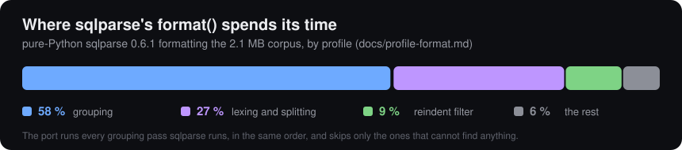
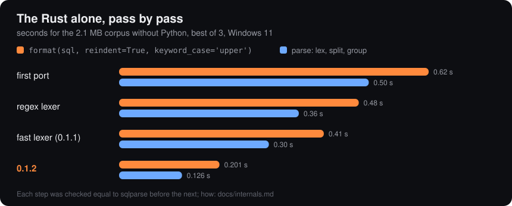

# Internals

- [How the lexer matches Python's `re`](#how-the-lexer-matches-pythons-re)
- [How the tree matches sqlparse's](#how-the-tree-matches-sqlparses)
- [Speed](#speed)

## How the lexer matches Python's `re`

Python 3.11 and Rust disagree on `\w`, `\s`, `\d`, `\b` and case-insensitive letters outside ASCII: Unicode 14
against a newer table, combining marks, numerics like `½`, `ſ` and the Kelvin sign.

[`tools/gen_lexer.py`](../tools/gen_lexer.py) writes `src/lexer_tables.rs` from sqlparse itself. Every character
class in `SQL_REGEX` becomes the exact set of code points Python's `re` matches, asked code point by code point.

- **Lookahead.** Patterns with lookahead run on fancy-regex, so backtracking behaves as in `re` (`123abc` lexes as
  `12` + `3abc` in both).
- **Lookbehind.** One-character lookbehinds are checked on the character before the match.
- **First characters.** Each rule gets the set of characters a match can start with, so a position only tries the
  rules that can match there.
- **Prefilters.** Each rule with lookaround gets a lookaround-free *prefilter* that every match also matches, run
  first on the regex crate's DFA. Where it finds nothing, the slow backtracking engine is skipped.
- **Hand-written matchers.** 88 % of tokens (spaces, words, punctuation, numbers, strings, comparison operators)
  are recognised by matchers that decide sqlparse's rules in sqlparse's order: `fast_token` in
  [`src/lexer.rs`](../rust/sqlparse-front/src/lexer.rs). Tests pin which rules each character can start. Every
  other case still runs the regexes: a non-ASCII character where `\w` or `\d` would matter, `$`/`#` in a word, an
  unclosed string, a word that can open a multi-word keyword (`GROUP BY`, `LEFT JOIN`; then only that keyword's
  own rules run).

## How the tree matches sqlparse's

[`src/tree.rs`](../rust/sqlparse-front/src/tree.rs) is `sql.py` on an arena,
[`src/grouping.rs`](../rust/sqlparse-front/src/grouping.rs) is `grouping.py` function by function, and
[`src/filters.rs`](../rust/sqlparse-front/src/filters.rs) the filters that work on the tree.

What sqlparse does by accident is kept, because output depends on it:

- a group's `value` is joined when the group is made and never refreshed. The reindent filter measures
  identifiers by it, and the Python/PHP output filters print it, after strip_whitespace has changed the leaves
  (`str()` is recomputed from the leaves, as in Python);
- `normalized`, `is_keyword` and `is_whitespace` are taken at creation (`group_operator` later retypes `*`);
- `_group` walks a copy of the list taken at the start, so a token already moved into a group is still looked at,
  with an index that is off; `tidx_offset` and the stale `prev_` are reproduced;
- `ttype in T.X` (subtypes) against `ttype in (T.X, T.Y)` (equality) and `isinstance(x, TokenList)` (any group)
  are told apart everywhere;
- tokens put in with `tokens.insert` have no parent, which `_current_line_len` and `within()` see;
- with an output format, the statement's tokens become a generator the serializer uses up, so the reindent filter
  separates the next statement as if the last one were `''`;
- the limits raise what sqlparse raises: grouping depth 100, 10,000 tokens, `right_margin` is
  `NotImplementedError`, and Python's own recursion limit, which ~980 nested BEGIN blocks or BETWEEN chains reach.

The recursion limit needs care. The port counts the frames sqlparse would use from the caller's real stack depth,
and asks Python for the exact headroom when close to the limit. It also knows that CPython 3.12+ no longer counts
C calls (such as `''.join`) against the limit. So it fails from exactly the same size as sqlparse on every
version.

## Speed

sqlparse spends 58 % of `format()` in grouping, 27 % lexing and splitting and 9 % in the reindent filter
([`profile-format.md`](profile-format.md)). Its quadratic spots, such as `_current_line_len` re-joining the whole
statement for every line, are walked backwards to the last line break in the port.

### The Rust alone

No Python (`cargo run --release --example bench_format`, `bench_lexer`, `bench_split`), same corpus, best of 3,
Windows 11, after each optimisation pass:

| Step | first port | regex lexer | fast lexer (0.1.1) | **0.1.2** |
| --- | ---: | ---: | ---: | ---: |
| lex (`tokenize`, 799k tokens) | 0.19 s | 0.087 s | 0.026 s | **0.021 s** |
| `split` | 0.21 s | 0.10 s | 0.032 s | **0.026 s** |
| `parse` (lex, split, group) | 0.50 s | 0.36 s | 0.30 s | **0.126 s** |
| `format(reindent=True, keyword_case='upper')` | 0.62 s | 0.48 s | 0.41 s | **0.201 s** |
| `format(strip_comments=True)` | 0.49 s | 0.37 s | 0.28 s | **0.147 s** |
| `format(reindent_aligned=True)` | 0.55 s | 0.41 s | 0.34 s | **0.178 s** |

The package adds little on top: the string crosses into Rust and back once per call, plus a look at the Python
stack for the recursion limit.

### What made it fast

Besides being Rust:

- tokens are spans into one string, and the tree is an arena of indices;
- grouping passes walk the tree instead of rebuilding lists;
- keyword lookups allocate nothing;
- the lexer skips most regex work (first-character table, DFA prefilters for lookaround rules: that pass made the
  lexer 2.2x faster).

### 0.1.2: grouping and memory

Measured pass by pass and with a profiler, every change checked equal:

- **Passes that cannot do anything are left out.** sqlparse runs all 25 grouping passes over every statement.
  Most statements have no `CASE`, `::`, `:=`, `OVER`, `[`, comment or `VALUES`, so the passes that start from
  those find nothing. A pass is skipped only when none of the tokens it starts from is in the statement *and* it
  could not have stopped on a limit either. The limits are sqlparse's grouping depth (100) and list length
  (10,000), which every `_group` pass checks on every list, and Python's recursion limit for the passes that count
  frames. So errors stay exactly where sqlparse raises them.
- **Fewer allocations.**
  - Tokens are no longer copied into a string each before the tree is built.
  - Passes walk a copy of each token list taken in one shared buffer, instead of a new vector per list and pass.
  - A node's own strings live in one list per tree, which shrinks a node from about 130 to 80 bytes.
  - The indent filters' keyword patterns no longer collect a keyword's characters fourteen times per look.
  - The module uses [mimalloc](https://github.com/microsoft/mimalloc) for the Rust's own allocations (6-14 % on
    Linux, 17-21 % on Windows, whose allocator is slow).
- **Token types are numbers.** A token's type was compared as a string (`Token.Keyword.DML`). It is now a number
  into the list of types, and `ttype in T.Keyword` is one bit in a table built at compile time.
- **Keywords are found by hash**, not by a binary search comparing about ten strings per word.

The step before was the lexer: the hand-written matchers above. The splitter also stopped allocating for keywords
and slices statements straight out of the text.

### 0.1.4: the Python side

Every change checked equal:

- **Objects without calls.** `parse()` made each node with `object.__new__` and set its nine slots with
  `setattr`. The package now finds once where sqlparse's classes keep those slots and writes them directly. Each
  found offset is checked by writing through it and reading back through Python, else the old way is used. The
  garbage collector is paused while a tree is built. `parse` over the corpus: 0.13 → 0.10 s.
- **Statements one at a time.** `FilterStack.run` groups a statement when it is asked for, as sqlparse's run
  does, and runs a leading `AlignedIndentFilter` or `ReindentFilter` in Rust. A caller's own stack with a
  `ReindentFilter`: 4.8x → 15.5x; the toolbar's panel 4.3x → 5.8x; `parsestream` 1x → 8.6x.
- **Bytes and streams** are read and decoded in Python as sqlparse does, then run in Rust (before, they all went
  to sqlparse): `format(bytes)` 1x → 87x.
- **Cheaper checks per call.** Whether sqlparse's default lexer is still sqlparse's is one call into Rust that
  compares its lists object by object: `format('select 1', keyword_case='upper')` 2.7 → 2.2 µs, `split` 1.3 →
  1.0 µs.

### 0.1.5: memory

`FilterStack.run` and `parsestream` lex 1,024 tokens at a time and split statements off as they are asked for,
through the same single lexer loop `format` and `split` use ([memory](benchmarks.md#memory)).

A gotcha found on the way: a second call site of the lexer's helpers made the compiler stop inlining them into the
whole-text loop, which cost `split` 10 % and `format` 7 %. There is one lexer loop function now, called with a
token budget, and both run as fast as in 0.1.4.

### What is left

No single hot spot is left: the time is spread over the grouping passes that do run, the lexer and the indent
filters. Going further would mean merging grouping passes, which sqlparse runs one after another over the whole
tree and whose order the output depends on.
