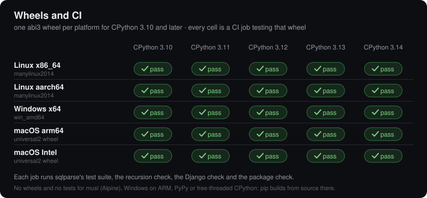

# How it is proven

## The method

The port is checked with [rust-anything](https://github.com/erkamyaman/rust-anything), a tool that records a
Python library's behaviour and replays it against a Rust port:

1. `upstream/` is sqlparse itself, a git submodule pinned to release **0.6.1**. Nothing in it is changed.
2. [`front/sqlparse_front.py`](../front/sqlparse_front.py) is the front door: `tokenize`, `split`, `format` with
   every option, and `parse_tree`. `parse_tree` is `parse()`'s tree as plain lists, so the tree is compared node
   by node.
3. `rust-anything record` runs the original on generated edge cases and real SQL, and saves what every call
   returns or raises. The inputs come from [`bench/make_inputs.py`](../bench/make_inputs.py): the benchmark
   corpus and sqlparse's own test files, through the option sets people use.
4. `rust-anything diff` replays all of it against the Rust (`rust/sqlparse-front/`). `fuzz` generates fresh
   inputs and compares the two live. `gate` runs fmt, clippy, tests, no-`unsafe`, no-panic and the replay.
5. The scripts in [`tools/`](../tools) go further than the recording: every Unicode code point through the lexer
   and case filters, hundreds of thousands of trees, the recursion threshold, and the package's public calls
   against sqlparse's.

## Every check

| What was checked | Result |
| --- | --- |
| Recorded cases (`rust-anything diff`): the original run on the corpus, sqlparse's own test files and generated edge cases, through every option | **7,842 / 7,842 identical**, errors included |
| sqlparse's own test suite, with `sqlparse_turbo.install()` | **537 passed**, same 2 xfail / 1 xpass as plain sqlparse |
| Statement trees (`tools/check_tree.py`): every node's class, value, type and parent, on the corpus, sqlparse's test files, 2,730 cuts of them, 40,000 random scripts and limit inputs | **260,837 calls, 0 differ** |
| Lexer (`tools/check_tokenize.py`): recorded texts, cuts of them, random texts | **32,986 texts, 0 differ** |
| Case filters over every Unicode code point (`tools/check_format_flat.py`) | **26.7 million texts, 0 differ** |
| Package against sqlparse (`tools/check_package.py`): corpus x 13 option sets, split, CLI, bad option types, lexer changes | **6,090 calls in Rust, 0 differ**; 18 out-of-range calls all answered by sqlparse |
| The Rust lexer under `install()`: `lexer.tokenize` and every node of `parse()` (class, token type object, value) on the corpus, sqlparse's test files and 3,000 random scripts; `split_many` against `split` | **3,460 texts, 0 differ**, all lexed in Rust; others (another Lexer, a changed one) left to sqlparse |
| Lexer and splitter over every Unicode code point (`tools/check_codepoints.py`, `tools/check_split.py`) | **12.2 million and 10.0 million texts, 0 differ** |
| Patched sqlparse (`check_package.py patches`): 6 kinds of patch x format, split, parse; recursion error chain | every patched call answered by sqlparse with the patch, back in Rust once put back; `SQLParseError` from a `RecursionError` as in sqlparse |
| Callers' own filter stacks through `FilterStack.run` (`check_package.py stacks`; `check_recursion.py package`), 17 stacks: grouping only, an `AlignedIndentFilter` or `ReindentFilter` in other states and options (run in Rust), filters of the caller's own after them, grouping turned off midway, statements taken one at a time, serializers | same trees, output and filter state (`_last_stmt`, `_last_func` the very token) as sqlparse's run, the recursion error from exactly the same size |
| Bytes and text streams (`check_package.py read`): 13 forms (bytes in several encodings, bytes that are not UTF-8, `StringIO`, `TextIOWrapper`, a stream that fails or reads something else) x 9 calls | **3,744 calls, 0 differ**: result, error and the stream's reads |
| Other sqlparse versions (`check_other_sqlparse.py`, in CI with 0.4.4, 0.5.3, 0.6.0) | every call answered by that sqlparse, nothing reaches the Rust |
| Django app (`check_django.py`, in CI on every platform and with the other sqlparse versions) | the app turns the Rust on with 0.6.1, `RunSQL`'s split and the debug SQL equal sqlparse's; with another sqlparse nothing replaced and `sqlparse_turbo.W001` |
| `str()` of statements (`check_str.py`, in CI on every platform) | 175,333 statements and groups of the corpus, 14 kinds of changed trees (values replaced, foreign tokens, `is_group` not a bool, unset slots, a cycle), trees 150 to 2,000 levels deep, callers near the limit, a patched `flatten`, 366 serializer stacks, `parsestream`: **0 differ**, and one leaf gives the very same object |
| django-debug-toolbar's SQL panel (`check_toolbar.py`, in CI on every platform) | both of its stacks' HTML on the corpus, 40 hand-picked cases, 5,000 random token soups, statements too deep to group, callers near the recursion limit: **0 differ**; a patched filter, `escape`, instance or a stack changed mid-run gets sqlparse's run |
| Package over every non-ASCII code point (`check_package.py unicode`), on each CPython 3.10-3.14 | the code points that behave as in 3.11 run in Rust, 0 differ; the drifted ones (see [Unicode versions](fallback.md#unicode-versions)) go to sqlparse |
| Fresh random cases (`rust-anything fuzz --time 600`) | **282,550 / 282,556**; the 6 pass `None` where the front door types `str`/`bool` (a known difference of the test bindings, see [Limits](limits.md)) |
| Python's recursion limit (`tools/check_recursion.py`): 18 deep-nesting shapes (7 of them through `FilterStack.run`), 3 caller depths, through C calls; 10 shapes (format, parse, split, `FilterStack.run`) called from each of the last 320 stack depths before the limit | **fails at exactly the same size** and **from exactly the same caller depth** on CPython 3.10, 3.11, 3.12, 3.13, 3.14 |
| Platforms, in CI ([`.github/workflows/ci.yml`](../.github/workflows/ci.yml)) from the built wheel | Linux x86_64 and aarch64 (manylinux2014), Windows x64, macOS arm64 and Intel (universal2) x **CPython 3.10, 3.11, 3.12, 3.13, 3.14**: all 25 combinations pass sqlparse's suite, the recursion check and the package check (the whole check, front door included, on Linux x86_64) |

## In CI

Every push to `main` and every release tag builds the wheels and tests each one on its platform, with each
CPython from 3.10 to 3.14. A release is uploaded to PyPI only after all of them pass.
